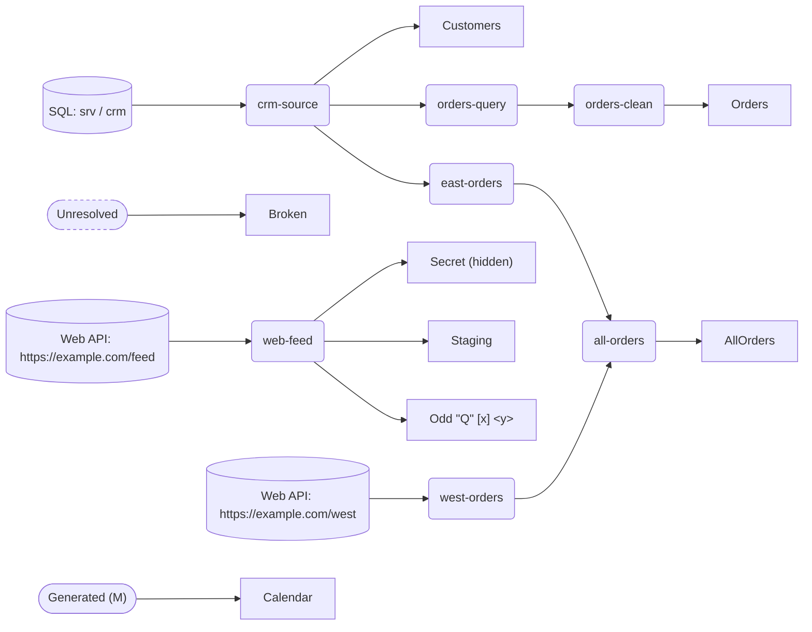

# lineage

**Contents**

- [Overview](#overview)
- [1. Data Sources](#data-sources)
- [2. Table Details](#table-details)
- [3. Measures](#measures)
- [4. Functions](#functions)
- [5. Relationships](#relationships)
- [6. Security Roles](#security-roles)
- [7. M Parameters](#m-parameters)
- [⚠ Unresolved Sources](#unresolved)
- [8. Model Statistics](#statistics)

---

<a id="overview"></a>
## Overview

| Property | Value |
|---|---|
| **Culture** | - |
| **Compatibility Level** | - |
| **Data Source Version** | - |

---

<a id="data-sources"></a>
## 1. Data Sources

This model contains 7 loaded tables, 1 measures-only table, 1 not loaded, 1 measure, 0 relationships.

| Table | Source Type | Source |
|---|---|---|
| `Orders` | SQL | orders-query -> crm-source -> SQL -> srv -> crm |
| `Customers` | SQL | SQL -> srv -> crm |
| `AllOrders` | Combined Queries | Combines: east-orders, west-orders |
| `Calendar` | Generated (M) | - |
| `Broken` | Unresolved | references 'missing-query' which does not exist |
| `Secret` (hidden) | Web API | Web API -> https://example.com/feed |
| `Odd "Q" [x] <y>` | Web API | Web API -> https://example.com/feed |

### Support Tables

| Table | Type |
|---|---|
| `_Measures` | Measures |

### Not Loaded

> These tables have `enableLoad = false` and are not visible in the report.
> They are typically used as intermediate query steps.

| Table | Source Type | Source |
|---|---|---|
| `Staging` | Web API | Web API -> https://example.com/feed |

### Lineage

> Sources on the left, report tables on the right, shared queries in between. Helper functions, scalar helpers and parameters are omitted.



---

<a id="table-details"></a>
## 2. Table Details

### `Orders`

**Source:** SQL  
**Server:** `srv`  
**Database:** `crm`  
**Chain:** `orders-query -> crm-source -> SQL -> srv -> crm`  

---

### `Customers`

**Source:** SQL  
**Server:** `srv`  
**Database:** `crm`  

---

### `AllOrders`

**Source:** Combined Queries  

---

### `Calendar`

**Source:** Generated (M)  

---

### `Broken`

**Source:** Unresolved  
**⚠ Unresolved:** references 'missing-query' which does not exist  

---

### `Secret`

**Source:** Web API  
**URL:** `https://example.com/feed`  
**Hidden:** Yes  

---

### `Odd "Q" [x] <y>`

**Source:** Web API  
**URL:** `https://example.com/feed`  

---


<a id="measures"></a>
## 3. Measures

### General

| Measure | Table | Format | Description |
|---|---|---|---|
| `Order Count` | `_Measures` | - | - |

**`Order Count`**
```dax
COUNTROWS(Orders)
```


**Format Strings Used (1 total, 1 unique)**

| Format String | Count | Measures |
|---|---|---|
| (none) | 1 | `Order Count` (_Measures) |

---

<a id="functions"></a>
## 4. Functions

*No user-defined functions defined.*

---

<a id="relationships"></a>
## 5. Relationships

*No relationships defined in this model.*

---

<a id="security-roles"></a>
## 6. Security Roles

*No security roles defined.*

---

<a id="m-parameters"></a>
## 7. M Parameters

*No M parameters defined.*

---

<a id="unresolved"></a>
## ⚠ Unresolved Sources

The following sources could not be resolved statically.
Use tmdl-lens to provide a manual label for each.

| Expression | Reason |
|---|---|
| `Broken` | references 'missing-query' which does not exist |

---

<a id="statistics"></a>
## 8. Model Statistics

| Category | Count | Items |
|---|---|---|
| Loaded Tables | 6 | `Orders`, `Customers`, `AllOrders`, `Calendar`, `Broken`, `Odd "Q" [x] <y>` |
| Hidden Tables | 1 | `Secret` |
| Calculated Tables | 0 | - |
| Field Parameters | 0 | - |
| Measures-Only Tables | 1 | `_Measures` |
| Calculation Groups | 0 | - |
| Not Loaded | 1 | `Staging` |
| Relationships | 0 | - |
| Measures | 1 | - |
| Calculated Columns | 0 | - |

---

*Generated by tmdl-lens*
